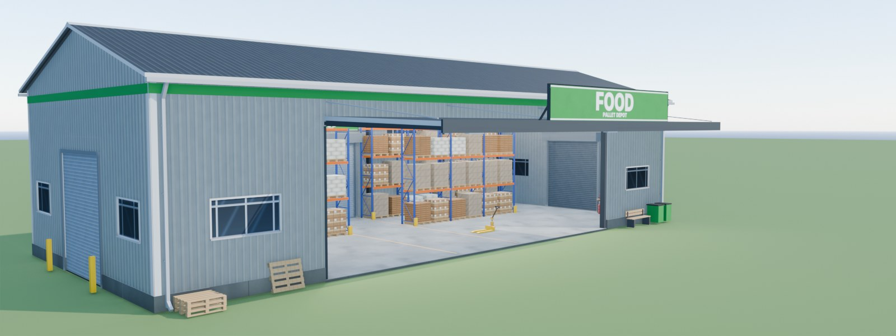
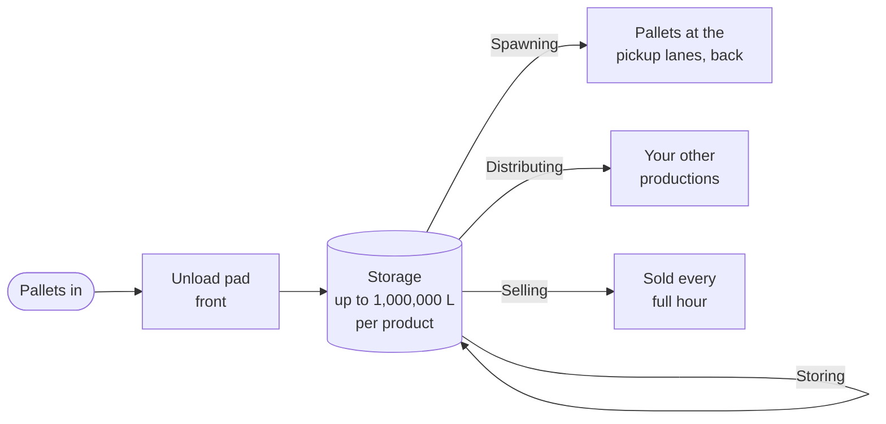
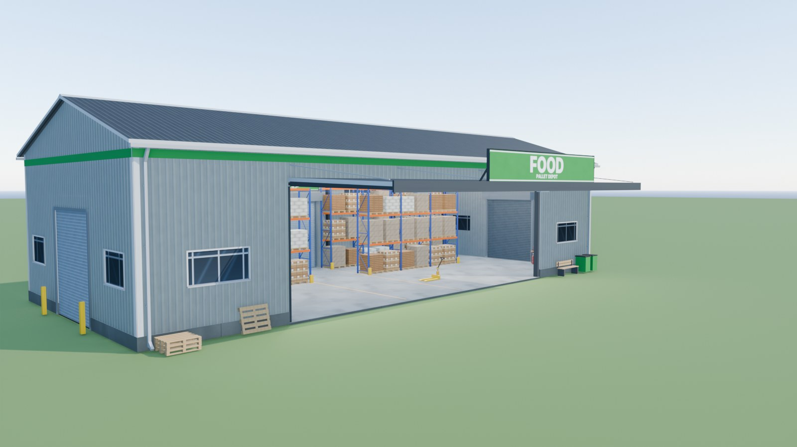
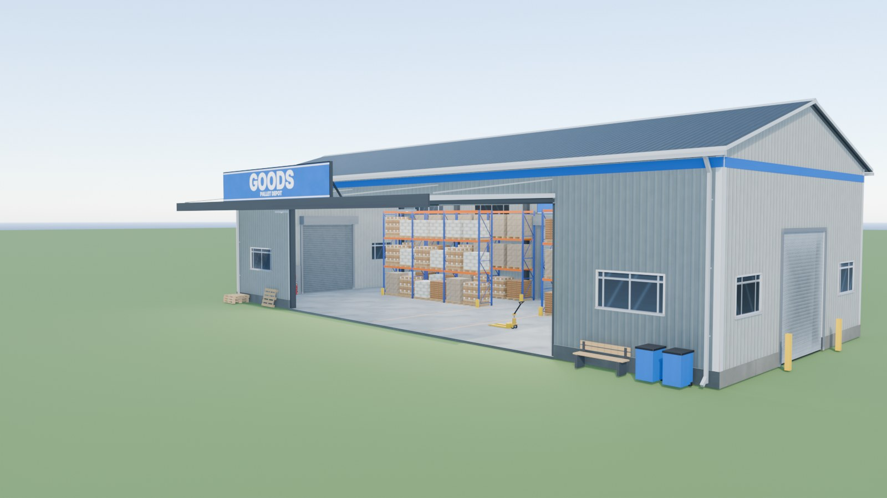
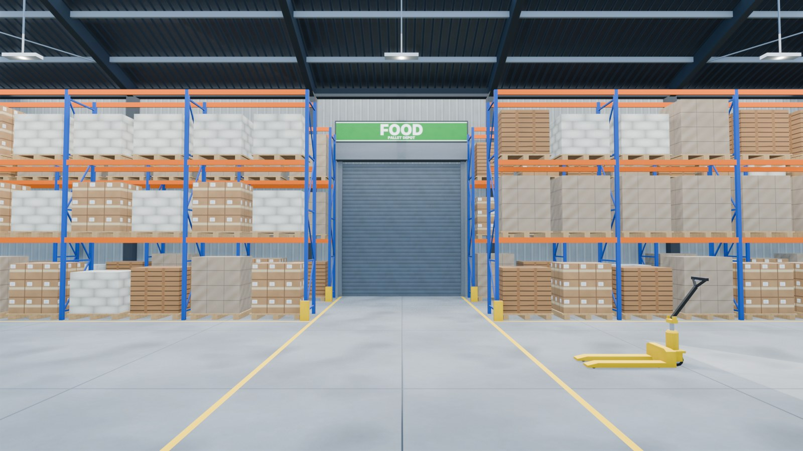
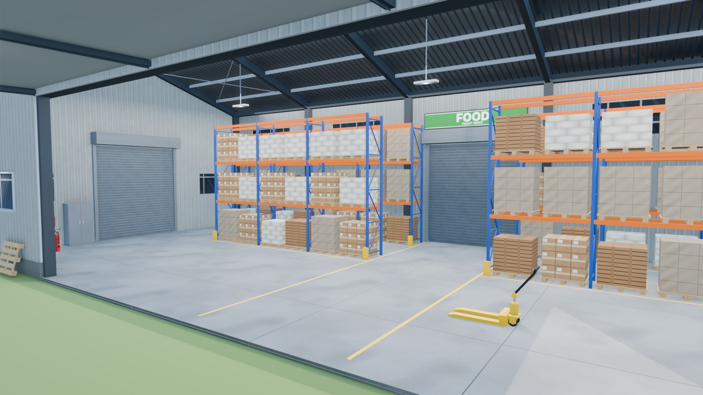
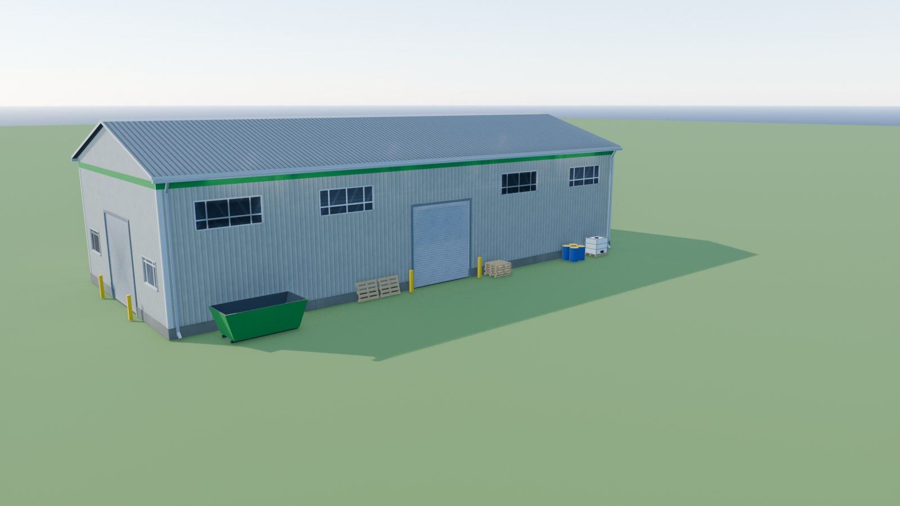
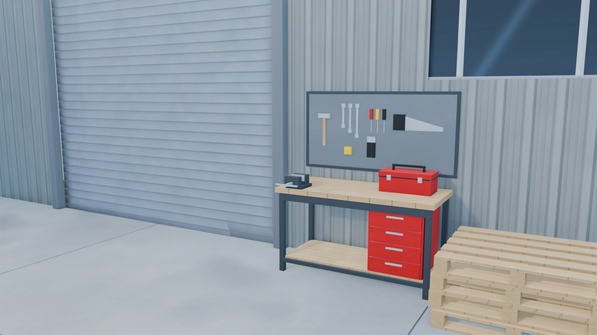

<div align="center">



# Pallet Depot

**A pallet hall for Farming Simulator 25 that stores your products and sends them on.**


</div>

Drop pallets on the unload pad at the front, then choose per product where it goes next. One depot can hold up to **1,000,000 L of every product** it takes.



Pallets only: bulk goods, field crops and bales are not accepted.

## Two depots

<table>
<tr>
<td width="50%"></td>
<td width="50%"></td>
</tr>
<tr>
<td><b>Food &amp; Drinks</b> (green sign)<br/>Dairy, bread and cakes, oils, flour, sugar, honey, vegetables, fruit, juices, canned and preserved food, rice products, soups.</td>
<td><b>Textiles &amp; Goods</b> (blue sign)<br/>Fabric, clothes, wool, rope, furniture, paper and carton, building materials (cement, planks, boards, roof plates, prefab walls), seeds, fertilizer, herbicide, lime, road salt.</td>
</tr>
</table>

Both cost 50,000 and have no daily upkeep. With the **FedMods** packs loaded (standard or ProEdition) they also take the Fed products: 184 products in Food & Drinks, 68 in Textiles & Goods. Without the packs they offer the base-game products.

## Features

- **Per-product routing**: store, spawn as pallets, deliver to your productions, or sell every full hour.
- **Capacity option** per depot: 100,000 / 500,000 / 1,000,000 L per product.
- **Your own pallets for every production**: any production with pickup lanes can spawn the game's pallets or this mod's **1,000 L / 5,000 L pallets**, which take any product of any map or mod.
- **Racks that fill up**: 84 pallet places that show the stock as it grows.
- **Working roller doors** on three sides. Open and close them like a garage door; their state is saved.
- **Daily report at 06:00**: what came in, went out, was delivered and was sold at each depot.
- **Hide empty materials** in the game's production menu (C), so a depot doesn't list 180 rows of 0 L.
- **AutoDrive route** imported when the depot is placed.

<table>
<tr>
<td width="50%"></td>
<td width="50%"></td>
</tr>
<tr>
<td width="50%"></td>
<td width="50%"></td>
</tr>
</table>

## Productions window

Press **Right Shift + P** for one table of **all** your productions, not only the depots, with their inputs (five per line), recipes, finances and logistics.

| Key | Main page | Logistics page |
|:---:|---|---|
| <kbd>X</kbd> | inputs / outputs | schedule: the months a line runs |
| <kbd>C</kbd> | recipes | hide inactive |
| <kbd>Q</kbd> | finances | spawn goods |
| <kbd>E</kbd> | logistics | |
| <kbd>Enter</kbd> | settings | change output |
| <kbd>Backspace</kbd> | spawn goods | recipe on / off |
| <kbd>Space</kbd> | CSV export | |
| <kbd>Esc</kbd> | close | close |

The **settings** page has:

- **Auto-management**: pauses stuck lines so they stop costing money, and restarts them when they can run again.
- **Alerts** for paused or restarted lines, low inputs and nearly full outputs.
- **Building options** for the selected production: the depot's capacity, and which pallets it spawns.

Settings, schedules and options are saved with the savegame and shared with all players on a server.

## Compatibility

| Mod | Needed? | What it adds |
|---|---|---|
| FedMods (standard or ProEdition) | optional | Fed products in both depots |
| Production Storage Control | optional | "Spawn goods" opens its spawn window with the product already selected; without it the button is hidden |
| AutoDrive | optional | imports the depot's route when it is placed |
| Price Ticker | optional | the depots are taken out of its station list (its files are not changed) |

Multiplayer works; the server and every player need the same zip.

## Installation

1. Get `FS25_PalletDepot.zip` (or build it, see below).
2. Put it into your mods folder, e.g. `Documents\My Games\FarmingSimulator2025\mods\`.
3. Don't rename the zip: savegames would treat it as a different mod.

The full changelog is at the end of the description in [`modDesc.xml`](modDesc.xml).

<details>
<summary><h2>Building from source</h2></summary>

The building, textures and pallets are generated by scripts, not modelled by hand; [`tools/layout.py`](tools/layout.py) holds every position. You need:

- Python 3
- Blender 5 with the GIANTS I3D exporter (10.0.x)
- GIANTS Editor 10 (for `textureTool.exe`)
- Farming Simulator 25 (reads `maps_fillTypes.xml`)

The paths to these are constants at the top of the scripts (default Steam and install locations); change them if yours differ.

Run from the repository root:

```sh
python tools/make_textures.py                                            # textures -> src/textures/, textures/*.dds
blender --background --factory-startup --python tools/build_warehouse.py # building -> i3d/depot.i3d, build/depot.blend
python tools/finish_i3d.py                                               # checks, food/goods i3d, build/i3d_mappings.json
blender --background --factory-startup --python tools/build_pallets.py   # pallets -> vehicles/*.i3d
python tools/gen_pallets.py                                              # vehicles/depotPallet*.xml
blender --background build/depot.blend --python tools/render_store.py    # shop images and mod icon -> store/
python tools/build_mod.py                                                # validate and zip -> build/FS25_PalletDepot.zip
```

`build_mod.py` regenerates the product lists (`products.py`, from the game data, [`tools/product_map.csv`](tools/product_map.csv) and the FedMods packs in your mods folder) and the placeable XMLs (`gen_placeables.py`) before it validates and zips the mod. `--bump` raises the version in `modDesc.xml` first. It checks XML, i3d mappings, file references, translations, Lua syntax and the GIANTS limits (at most 128 files, Lua files at most 0.5 MB).

For script or XML changes only, `build_mod.py` alone is enough; rerun the earlier steps only when the model, textures or layout change. The README images come from `blender --background build/depot.blend --python tools/render_readme.py`.

### Repository layout

| Path | Contents |
|---|---|
| `modDesc.xml` | Mod definition, all texts (English, German), full changelog |
| `scripts/` | Lua scripts (one file per feature) |
| `gui/` | Productions window and schedule dialog |
| `placeables/`, `i3d/`, `vehicles/`, `textures/`, `store/` | Game files packed into the zip (generated) |
| `src/` | PNG sources of the textures and shop images |
| `tools/` | Python and Blender pipeline: model, textures, placeables, pallets, zip |
| `build/` | Build output; only `products.json` and `i3d_mappings.json` are committed |
| `docs/images/` | README images |

</details>

## Credits

Building, textures and scripts by Fennell. Sign lettering set in Inter (SIL Open Font License).
